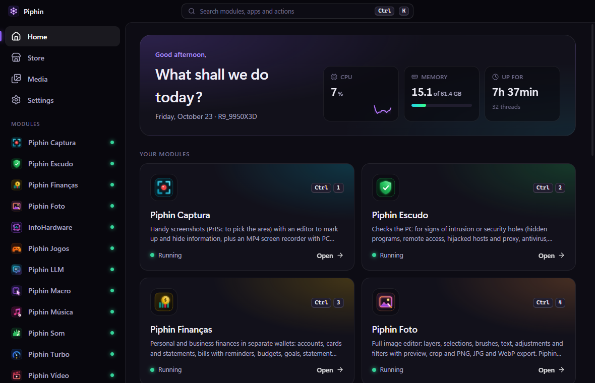
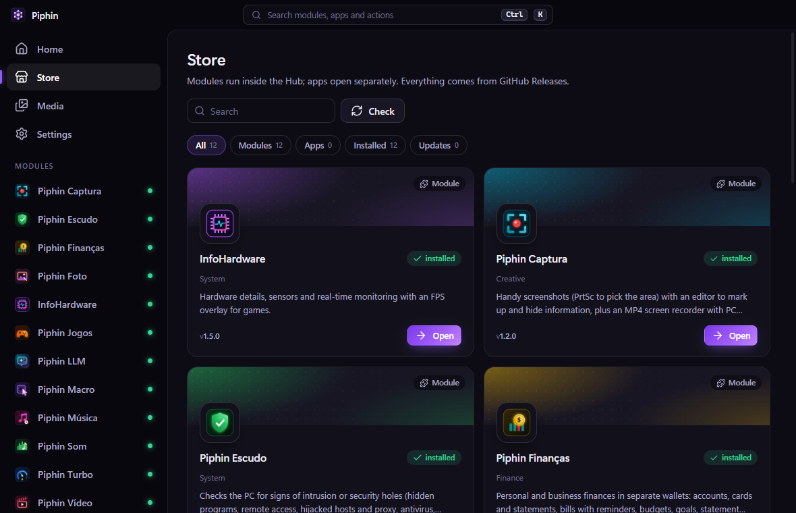
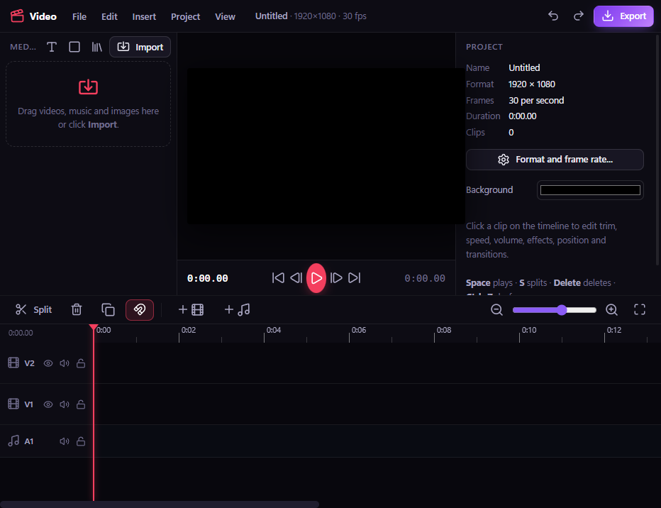
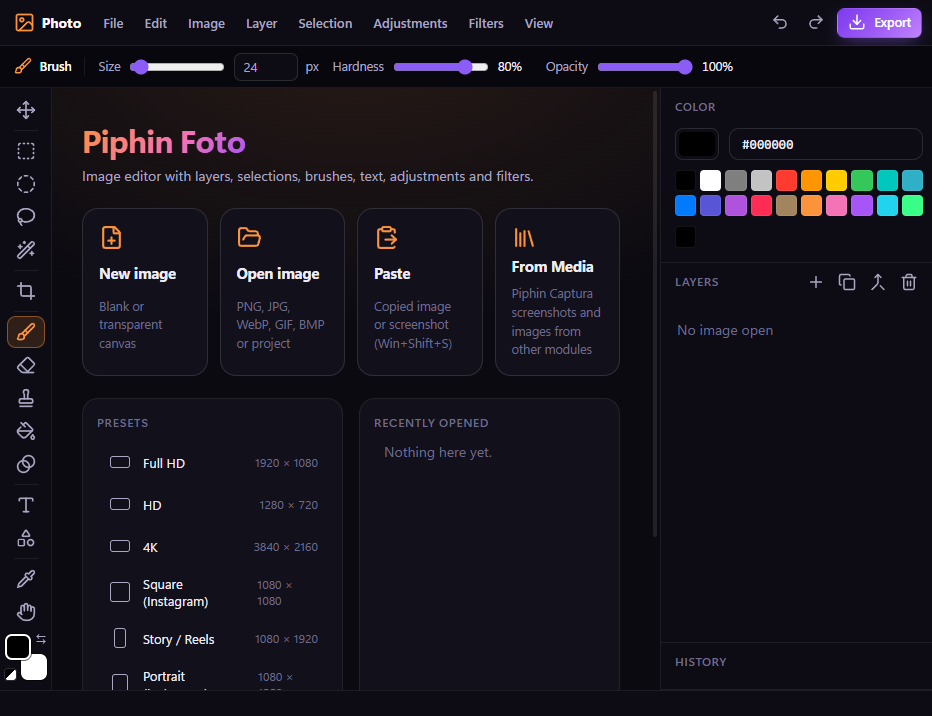
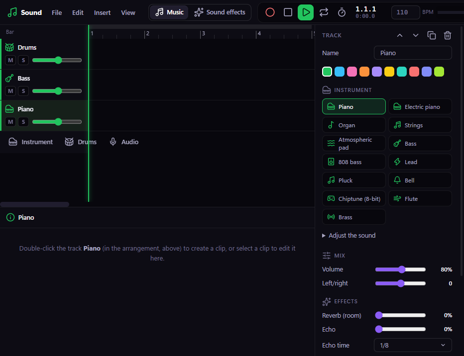
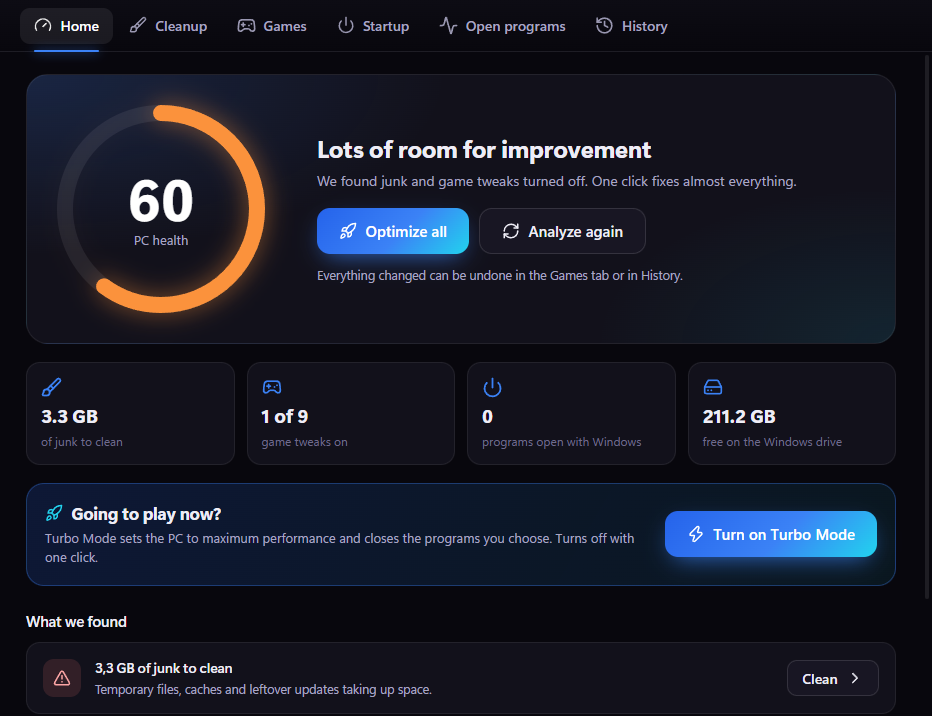
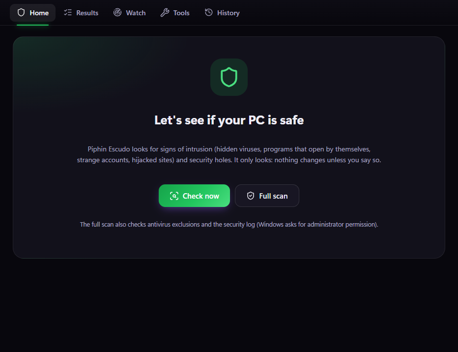
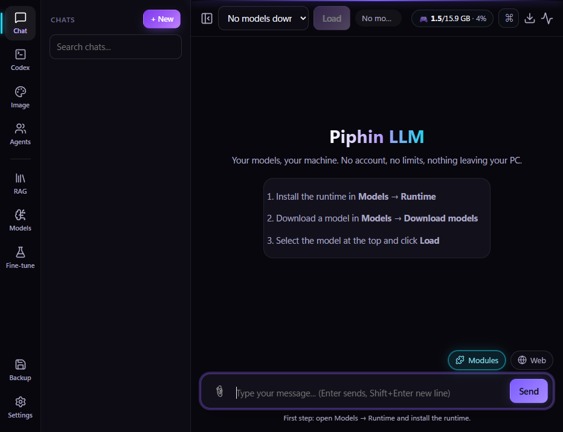
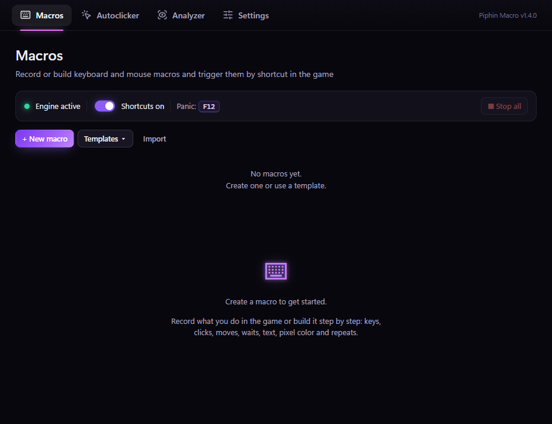

# Piphin Hub

**Your all-in-one PC toolkit.** Video, photo, music, gaming, security, finance and local AI in one app that installs and updates everything for you.

🇧🇷 🇺🇸 🇪🇸 🇹🇭 🇨🇳 🇯🇵 🇰🇷 🇮🇩 🇻🇳 🇫🇷 🇩🇪 🇷🇺

[**Download**](https://github.com/Ruiso-Outside/Piphin-Hub/releases/latest) · [Features](#-whats-inside) · [Install](#-install) · [Languages](#-languages) · [License](#-license)

## ✨ Why Piphin Hub

- **One place for everything.** Every tool opens inside the Hub, with its own shortcut (Ctrl + 1, 2, 3...) and a search bar for modules, apps and actions (Ctrl + K).
- **Tools that work together.** What one tool creates, the others can use. Songs you download show up in the video editor, screenshots open in the photo editor, sound effects go straight to your timeline. The **Media** screen keeps it all in one place, and you can drag any file into other programs.
- **Always up to date.** The Hub updates itself and every tool in the background, checks each download's SHA-256, and goes back to the previous version if anything fails.
- **Light.** Tools run inside the Hub, so most of them are only a few hundred KB. If one stops, the Hub and the others keep running.
- **Private.** No account, no ads, no telemetry. The Hub only talks to GitHub, to check for new versions and download them.

## 🧩 What's inside

| | Tool | What it does |
|---|---|---|
| 🎬 | **Piphin Vídeo** | Video editor: multi-track timeline, cuts, text and captions, effects, transitions, speed and MP4 export |
| 🖼️ | **Piphin Foto** | Image editor: layers, selections, brushes, text, adjustments and filters, PNG/JPG/WebP export |
| 🎵 | **Piphin Som** | Music and sound effects studio: instruments, drums, piano roll, ready-made chords and rhythms, recording and mixing |
| 🎧 | **Piphin Música** | Free Creative Commons and public-domain music, with license and credit info, ready for your videos |
| 📸 | **Piphin Captura** | Screenshots with an editor to mark up and hide information, plus MP4 screen recording with PC audio |
| 🎮 | **Piphin Jogos** | All your games from every store (Steam, Epic, Riot, GOG, Ubisoft, EA, Battle.net, Xbox...) in one library, with play time |
| ⚡ | **Piphin Turbo** | Speeds up your PC for gaming: health check-up, safe cleanup and Windows tweaks you can undo |
| 🛡️ | **Piphin Escudo** | Checks your PC for intrusion signs and security holes. It only looks: nothing changes unless you say so |
| 💰 | **Piphin Finanças** | Personal and business finances in separate wallets: accounts, cards, bills with reminders, budgets, goals and reports |
| ⌨️ | **Piphin Macro** | Keyboard and mouse macros, recorder, autoclicker and an anti-macro analyzer to test your own games |
| 🖥️ | **InfoHardware** | Hardware info, live sensors, a quick benchmark and an in-game FPS overlay |
| 🤖 | **Piphin LLM** | Local AI on your PC: chat with attachments, a coding agent, image generation and quick questions. Nothing is sent online |

Install the ones you want from the **Store** screen, with one click.

## 🖼️ Screenshots

<table>
  <tr>
    <td>
<b>Store</b>: install any tool with one click
</td>
    <td>
<b>Piphin Vídeo</b>
</td>
  </tr>
  <tr>
    <td>
<b>Piphin Foto</b>
</td>
    <td>
<b>Piphin Som</b>
</td>
  </tr>
  <tr>
    <td>
<b>Piphin Turbo</b>
</td>
    <td>
<b>Piphin Escudo</b>
</td>
  </tr>
  <tr>
    <td>
<b>Piphin LLM</b>
</td>
    <td>
<b>Piphin Macro</b>
</td>
  </tr>
</table>

## 🌍 Languages

| | | | |
|---|---|---|---|
| 🇧🇷 Português | 🇺🇸 English | 🇪🇸 Español | 🇹🇭 ไทย |
| 🇨🇳 简体中文 | 🇯🇵 日本語 | 🇰🇷 한국어 | 🇮🇩 Bahasa Indonesia |
| 🇻🇳 Tiếng Việt | 🇫🇷 Français | 🇩🇪 Deutsch | 🇷🇺 Русский |

Choose in **Settings → General → Language**. *Automatic (Windows language)* follows your Windows language. The change applies instantly to the Hub, every tool, Windows dialogs, dates and numbers.

## 📥 Install

1. Download **`Piphin-Hub-X.Y.Z-win-x64.zip`** from the [latest release](https://github.com/Ruiso-Outside/Piphin-Hub/releases/latest).
2. **Before extracting**, right-click the `.zip` → **Properties** → check **Unblock** → **OK**.
   This keeps Windows from blocking the Hub's shortcuts. If you forget, the Home screen shows an **Unblock Hub files** button.
3. Extract it to a permanent folder (for example `C:\Piphin Hub`) and open **`Piphin Hub.exe`**.
4. Open the **Store** and install the tools you want.

**Requirements:** Windows 10 or 11, 64-bit. Piphin LLM needs Python 3.9+, and a graphics card is recommended for large AI models.

**Your data** lives in `%APPDATA%\Piphin Hub`. Removing a tool keeps its data on your PC.

## ❓ FAQ

<b>Is it free?</b>

Yes, for personal and noncommercial use. See the [license](#-license).

<b>Does it start with Windows?</b>

Only if you turn it on in **Settings → Start with Windows**. The Hub then opens hidden next to the clock, so tool shortcuts (like macros) work right away.

<b>How do updates work?</b>

The Hub checks for new versions when it opens and regularly while it runs, downloads them in the background and asks before restarting. Tools update without restarting the Hub.

<b>Some tools need administrator permission. Why?</b>

Reading CPU temperatures (InfoHardware), applying some Windows tweaks (Piphin Turbo) and running a full security scan (Piphin Escudo) need it. Windows always asks first. If you say no, only that action is skipped; everything else keeps working.

## 💬 Feedback

Found a bug or have an idea? [Open an issue](https://github.com/Ruiso-Outside/Piphin-Hub/issues). Screenshots and steps to reproduce help a lot.

## 📄 License

Copyright © 2026 Piphin Studio. Released under the **[PolyForm Strict License 1.0.0](LICENSE.md)**.

| ✅ Allowed | ❌ Not allowed |
|---|---|
| Downloading and using Piphin Hub and its tools for free, for personal and noncommercial purposes | Modifying the software or creating works based on it |
| Use by schools, charities, research and public institutions | Redistributing or reselling the software |
| Reading the source code | Any commercial use or making money from this project |

For any use not covered by the license, contact Piphin Studio through the [issues page](https://github.com/Ruiso-Outside/Piphin-Hub/issues).

For developers

How the Hub works, the module system and the catalog are documented (in Portuguese) in [docs/DEVELOPERS.md](docs/DEVELOPERS.md).

